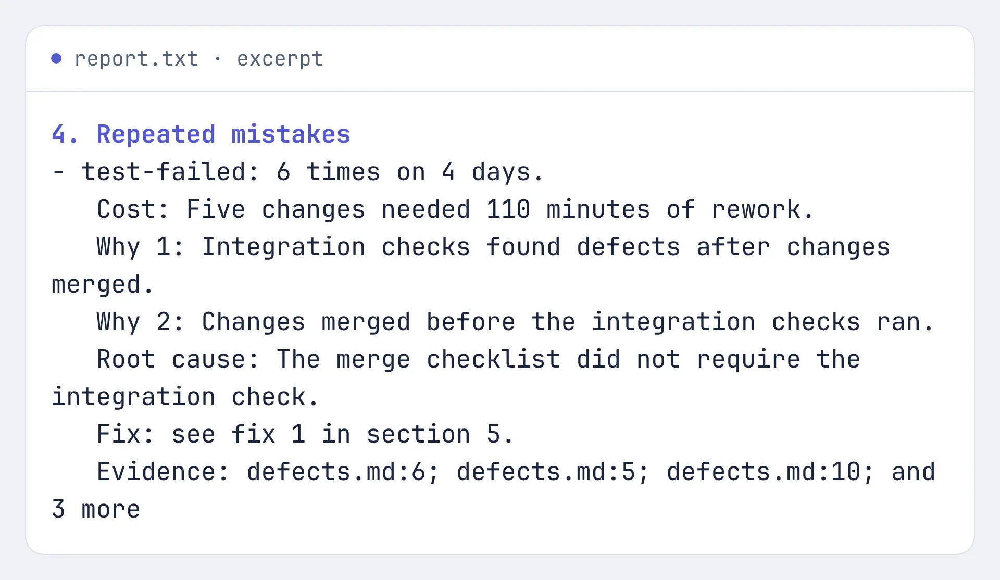

<div align="center">

<h1><br>learn-from-mistakes</h1>

**Find repeated coding-agent mistakes. Get evidence-backed fixes.**

A CLI for developers tired of correcting the same mistakes.

<picture>
  <source media="(max-width: 600px) and (prefers-color-scheme: dark)" srcset="docs/media/retro-hero-phone-dark.webp">
  <source media="(max-width: 600px)" srcset="docs/media/retro-hero-phone-light.webp">
  <source media="(prefers-color-scheme: dark)" srcset="docs/media/retro-hero-dark.webp">
  
</picture>

[Quick start](#quick-start) · [Docs](docs/reference.md) · [Demo](docs/demo.md) · [Vision](VISION.md)

[](https://www.npmjs.com/package/learn-from-mistakes-axi) [](https://nodejs.org/) [](LICENSE)

</div>

## Quick start

Run these in your project, with **Node 22.13+** and your agent CLIs installed and signed in:

```sh
npm i -g learn-from-mistakes-axi
learn-from-mistakes-axi init
learn-from-mistakes-axi retro
```

Pass `--wait` on that last command to block for up to eight minutes (the default). In a terminal, `init` asks which worker, judge and models to use. One agent can fill both roles. Review the sources it writes before running the retro: a defect log, failed checks or the sessions of agents you choose. Models use your own subscription or paid provider. [Non-interactive setup and source configuration →](docs/reference.md#no-terminal-or-no-agentmodel-selected)

After `completed`, run `learn-from-mistakes-axi report` and open the file named by `report_txt`. The terminal summary is not the full report. If the run is still `running` after the eight-minute wait, use `learn-from-mistakes-axi attach` to follow it.

**Your project is not changed by default.** The report proposes fixes; you decide what to change.

## Why use it instead of another manual retro?

Writing “don't do that again” in `AGENTS.md` is a start. It doesn't tell you whether the rule helped.

- **Find what repeats.** Manual: read the records and tally causes yourself. This tool: groups repeated causes, with counts, days and source pointers.
- **Check the explanation.** Manual: arrange a review of your reasoning. This tool: a judge checks the findings and proposed fixes; both roles must run.
- **Make the fix fit.** Manual: find the relevant project rule yourself. This tool: reads bounded project context and names the rule a fix replaces or extends.
- **See whether it helped.** Manual: keep a separate before/after record. This tool: tracks recorded changes and measures them in later retros.

## What you get

- **Causes, not just a failure list.** Each kept finding has a cost and a why chain down to the process, rule, tool or check behind it. Unread records stay unlabelled.
- **A report you can question.** Evidence pointers, judge verdicts and a **Not checked** section. Check the omissions before acting; an empty result does not prove nothing went wrong. A failed role fails the retro.
- **Fixes tied to your project.** The report names the files it read and the project rule each fix would replace or extend. [Applying and tracking changes →](docs/reference.md#apply-only-when-requested)
- **One failure worth investigating?** Incident mode reads only the evidence you name and your project's files, not your configured sources. It writes a timeline, root causes, missed checks and fixes with owners, priorities and due dates. A shipped incident fix stays open until its check passes. [Incident walkthrough →](docs/reference.md#go-deep-on-one-incident)

## Real output, with the limits left in

The hero is an unchanged excerpt of a report saved by **npm version 0.7.0** on six made-up defect records. The run found one repeated cause across four days. Its proposed fix passed the report rules, but the judge **weakened** it. Nothing was applied.

The example's 110 minutes are part of the synthetic input, not measured customer savings. This is a reproducible demonstration, not a quality benchmark. [Inputs, model, full result and capture method →](docs/demo.md)

## Setup and privacy

`learn-from-mistakes-axi doctor` checks readiness without calling a model. Follow its `fix:` lines and run it again. `init` also installs a discovery skill for your chosen agents; `init --no-skill` skips it. No supervisor or optional integration is needed.

**Excerpts and bounded project context go to your chosen providers, after redaction.** Redaction is not a guarantee. Inspect sources first; don't use records you cannot share. [Privacy and excerpt controls →](docs/reference.md#sources-state-and-privacy)

## More

- [Reference](docs/reference.md): agents, models, sources, costs, recovery, versions and exit codes.
- [Optional integrations](docs/reference.md#optional-integrations-and-changes): extra records, report handoffs and applying a fix.
- [Product page](https://umeranjum17.github.io/learn-from-mistakes/) · [Vision](VISION.md) · [Issues](https://github.com/umeranjum17/learn-from-mistakes/issues).
- [Development and verification](docs/reference.md#development): contributor commands and real CLI journeys.

[MIT](LICENSE)
