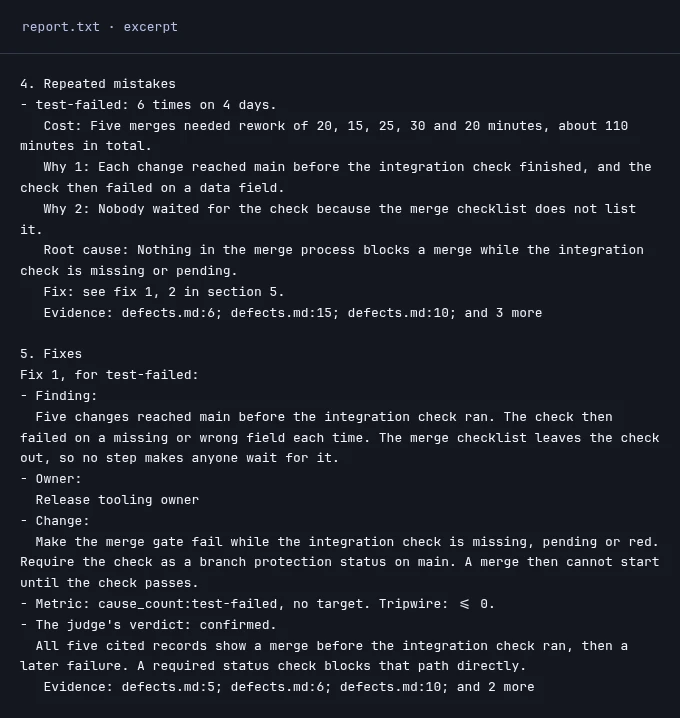

<h2> learn-from-mistakes</h2>

**A CLI that finds repeated coding-agent mistakes and proposes evidence-backed fixes.**

For developers tired of fixing the same agent mistakes.

### Start in your project

<p><code>npm install -g learn-from-mistakes-axi</code><br>
<code>learn-from-mistakes-axi init</code><br>
<code>learn-from-mistakes-axi retro --wait</code></p>

Needs **Node 22.13+**, project records and signed-in agents. Review the sources `init` writes before the first run.

<picture>
  <source media="(max-width: 600px)" srcset="docs/media/retro-demo-mobile.webp">
  
</picture>

*Real report excerpt, not a mock-up. Six made-up defect records, read by Claude Code with Sonnet 5.5 as worker and judge. The report kept one fix and the judge confirmed it. [Demo inputs and capture notes](docs/demo.md).*

## From repeated failures to a checked report

1. **Read the records.** The worker reads your configured sources and finds repeated causes. Unread records stay unlabelled.
2. **Check the claims.** A judge checks each finding, then each proposed fix. Both roles always run; a failed role fails the retro.
3. **Keep the evidence.** The report names the records behind each finding, the fixes that passed and what was not checked. Before it proposes fixes the retro reads a bounded set of your project's own files, and the report names the project rule each fix replaces or extends. You decide what to change. **Your project is not changed by default.**

`--wait` waits up to eight minutes. If the result is still `running`, let it finish:

```sh
learn-from-mistakes-axi attach
```

After `completed`, find the saved report:

```sh
learn-from-mistakes-axi report
```

Open the file named by `report_txt` in your editor. The terminal summary is not the full report. Check **Not checked** before drawing conclusions; an empty result does not prove nothing went wrong.

## With or without Firstmate

**On its own:** the tool reads the sources you set for your project: a defect log, failed checks or the sessions of agents you name. Nothing else is needed.

**With Firstmate:** you can opt in to also read its task logs and messages as extra records. It is never turned on for you. [Integration setup →](docs/reference.md#firstmate)

## Need help with setup?

`init` asks you to choose a worker, a judge and their models. One agent can fill both roles. It also installs a discovery skill for the agents you select; `init --no-skill` skips that optional install. Models use your own subscription or paid provider.

```sh
learn-from-mistakes-axi doctor
```

Follow each `fix:` line, then run it again. This checks readiness without calling a model. If you have no defect log or supported records yet, [configure a source](docs/reference.md#no-terminal-or-no-agentmodel-selected) first. In a non-interactive shell, provide your own agent and model choices through the [setup flags](docs/reference.md#no-terminal-or-no-agentmodel-selected).

**Privacy:** excerpts are sent to the providers you choose, after redaction. Redaction is not a guarantee. Inspect sources first; do not use records you cannot share. [Privacy and excerpt controls](docs/reference.md#sources-state-and-privacy).

## Go deeper

- [Product page](https://umeranjum17.github.io/learn-from-mistakes/) — the short tour.
- [Reference](docs/reference.md) — agents, models, sources, costs, recovery and exit codes.
- [Optional integrations](docs/reference.md#optional-integrations-and-changes) — Firstmate, sign-off and applying a fix.
- [Development and verification](docs/reference.md#development) — contributor commands and real CLI journeys.
- [Issues](https://github.com/umeranjum17/learn-from-mistakes/issues) · [MIT license](LICENSE).
