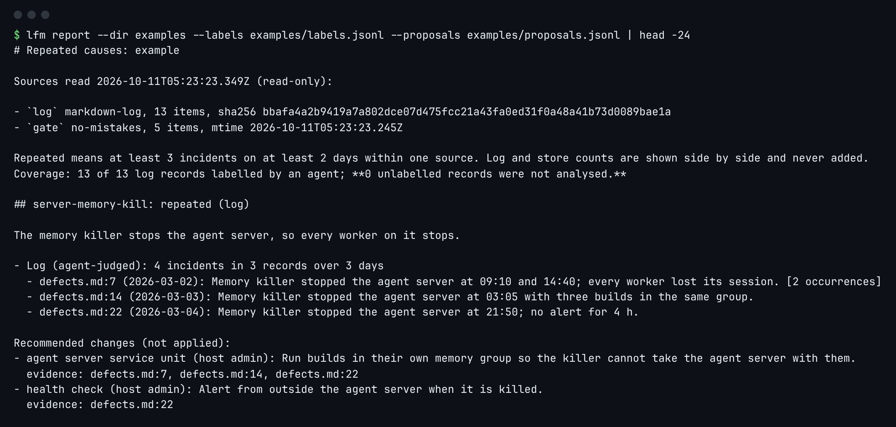
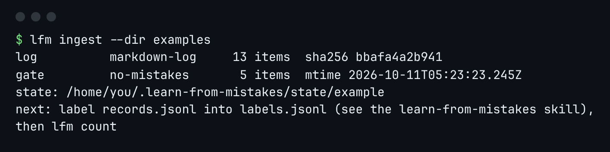
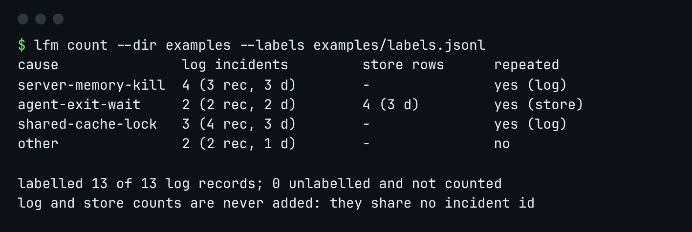
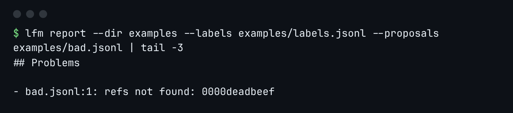
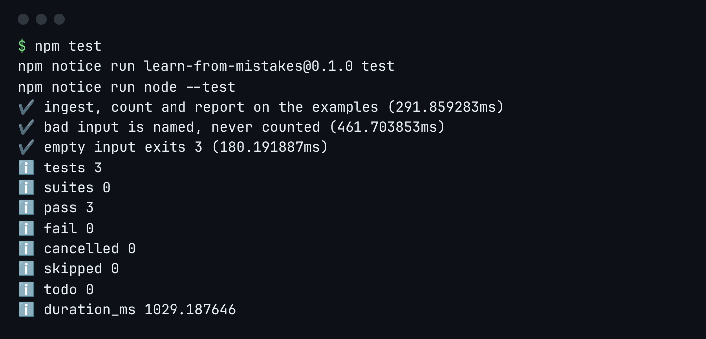

<p align="center"></p>

<h1 align="center">learn-from-mistakes</h1>

<p align="center">Find the mistakes your coding agents keep repeating, with the evidence for each, and a short list of changes to stop them.</p>

<p align="center"></p>

## Why

Agent fleets write down what went wrong: a defect log, a pipeline's failed steps. The same cause turns up again and again, yet nobody counts it, so the fix never gets priority. Counting by keyword is wrong too: "database is locked" in one tool is not the same cause as in another.

`lfm` splits the work. Your agent reads each record and judges what happened, using the bundled skill. The CLI does the arithmetic: it merges duplicates, counts each source separately, checks that every recommendation cites real records, and lists what was never read.

<table>
<tr><td><b>Ingest</b>: sources read, with hashes<br></td>
<td><b>Count</b>: log and store side by side<br></td></tr>
<tr><td><b>Problems are named</b>: a change citing a missing record<br></td>
<td><b>Tested end to end</b>: the real CLI on synthetic fixtures<br></td></tr>
</table>

## Quick start

Needs Node 22.13 or newer.

1. Install:

   ```sh
   git clone https://github.com/umeranjum17/learn-from-mistakes
   cd learn-from-mistakes && npm install && npm link
   ```

2. Read the example sources:

   ```sh
   lfm ingest --dir examples
   ```

3. Print the report:

   ```sh
   lfm report --dir examples --labels examples/labels.jsonl --proposals examples/proposals.jsonl
   ```

The examples are synthetic: a 13-record defect log, a small no-mistakes store, and labels written by following the skill.

## Use it on your own records

1. Put `.learn-from-mistakes.yaml` in your project:

   ```yaml
   name: my-project
   sources:
     log: { type: markdown-log, path: defects.md }        # each "- " bullet is a record; "## 2026-03-02" headings date it
     gate: { type: no-mistakes, path: ~/.no-mistakes/state.sqlite }   # failed steps, opened read-only
   causes:
     agent-exit-wait:
       description: A pipeline step fails because the agent's output pipe stays open.
       match: { source: gate, error_contains: "wait delay expired" }  # optional: count typed store rows
   repeat: { min_incidents: 3, min_days: 2 }
   ```

2. Run `lfm ingest`. It prints the state dir (`~/.learn-from-mistakes/state/<name>`; set `LFM_HOME` to move it).
3. Ask your agent to follow [`skills/learn-from-mistakes/SKILL.md`](skills/learn-from-mistakes/SKILL.md). It writes `labels.jsonl` and `proposals.jsonl` in the state dir.
4. Run `lfm count`, then `lfm report > report.md`.

Exit codes: `0` ok, `1` a label or proposal has a problem (listed in the output), `2` bad usage or config, `3` the sources hold nothing.

## What it does not do

`lfm` never edits your sources, instructions or config, and it makes no network or model calls. It does not apply the recommended changes or measure whether they worked. Records nobody labelled are reported as unlabelled, never guessed.
